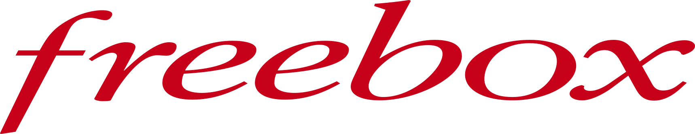
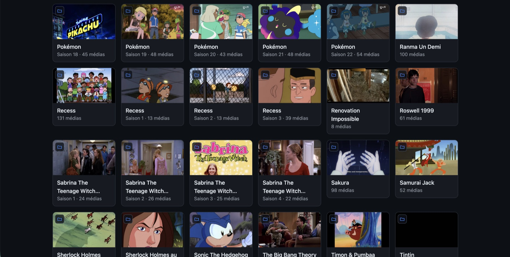
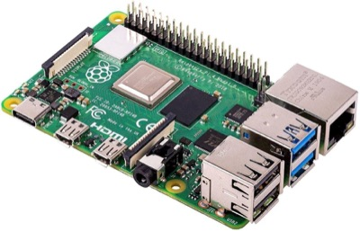
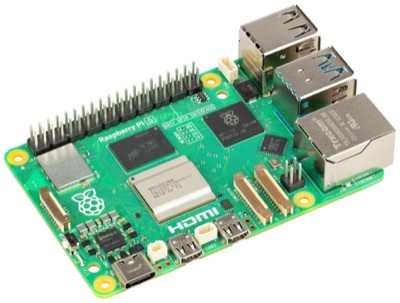
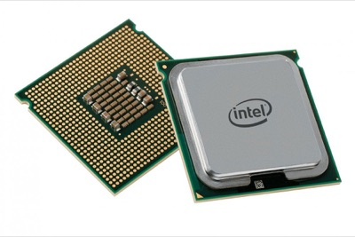
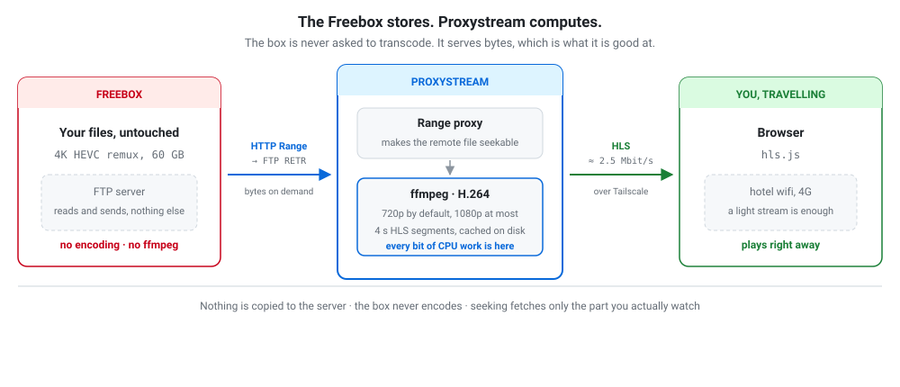

<h1 align="center">freebox-proxystream</h1>

<p align="center">
  
</p>

<p align="center">
  Stream the media stored on your Freebox over FTP, from anywhere,<br>
  without copying anything to the server.
</p>

<p align="center">
  <strong>Unofficial community project, free and open source.</strong><br>
  <sub>Not developed, endorsed or supported by Free / Iliad. Do not ask them for help with it.</sub>
</p>

The files stay on the Freebox. A small Go service exposes them to `ffmpeg` as a
seekable HTTP resource, transcodes them on demand to H.264, and serves the
result as HLS to a browser. It is built for one person watching their own
library while travelling, on hotel wifi or 4G.

Put whatever you like in your library: 4K HEVC 10-bit remuxes are welcome and
nothing is ever refused for being too big. **What is capped is the encoder
output, at 720p by default and 1080p at most** — a 2160p source is simply
downscaled on the way out. The two output options are switchable per playback
from the detail page.

<p align="center">
  
</p>

<p align="center">
  <sub>The library mirrors your own folder tree, and every thumbnail is a frame taken
  from the middle of the file &#8212; not artwork fetched from a catalogue.</sub>
</p>

## What it does

- **No local copy, ever.** `ffmpeg` reads HTTP Range requests from a loopback
  proxy that translates them into FTP `REST`/`RETR`. Seeking into the middle of
  a 60 GB remux downloads only the part being watched.
- **Seeking without seek logic.** The HLS playlist is generated from the probed
  duration before anything is encoded, so the player treats the file as an
  ordinary VOD asset. A segment request is answered from disk, from the running
  encoder, or by starting a new encoder at exactly that point.
- **Downscales, never upscales.** Any source resolution is accepted; the encoder
  just never emits more than 1080p, so a 2160p remux comes out at 1080p or 720p.
  In the other direction it leaves the source alone: a 480p file stays 480p at
  both settings, and shares a single cache entry instead of being encoded twice.
  The output height is always `min(chosen rendition, source height)`.
- **Audible dialogue.** Multichannel audio is downmixed to stereo, which is the
  difference between a watchable 5.1 film on a phone and an inaudible one.
- **Survives restarts.** The segment cache lives on disk and is reconciled with
  its index at startup; playback resumes where it stopped.
- **No online catalogue.** Titles come from your own folder and file names, and
  posters are a frame taken from the middle of each video. If you want a
  synopsis, you write it. Nothing is sent anywhere.

## Requirements

- `ffmpeg` and `ffprobe` (5.x or later)
- A Freebox with FTP enabled, reachable from the server
- Go 1.26+ to build from source
- A machine that can encode H.264 (see below)

## Which machine can run this

Every stream is transcoded, unconditionally: there is no direct-play path. So
the only question that matters when picking a box is whether it can produce
H.264 fast enough, one way or another.

<table>
<tr>
<td align="center" width="33%"></td>
<td align="center" width="33%"></td>
<td align="center" width="33%"></td>
</tr>
<tr>
<td align="center"><strong>Raspberry Pi 3 &amp; Pi 4</strong></td>
<td align="center"><strong>Raspberry Pi 5</strong></td>
<td align="center"><strong>x86 / Apple Silicon</strong></td>
</tr>
<tr>
<td align="center">✅ <strong>OK</strong></td>
<td align="center">❌ <strong>KO</strong></td>
<td align="center">✅ <strong>OK</strong></td>
</tr>
<tr>
<td>Both have a <strong>hardware H.264 encoder</strong>: VideoCore IV on the
Pi 3, VideoCore VI on the Pi 4. That block is the only reason boards this small
can keep up at all.</td>
<td>The BCM2712 <strong>dropped the H.264 encoder</strong>. Only an HEVC decoder
remains, and the four Cortex-A76 cores cannot encode 720p in software fast
enough to stream.</td>
<td>Quick Sync, NVENC, VCN or VideoToolbox all provide an H.264 encoder, and
these CPUs are also fast enough to encode <strong>in pure software</strong>.</td>
</tr>
</table>

The rule of thumb: **a Pi 5 is a downgrade from a Pi 3 or a Pi 4 for this
workload**, which is counter-intuitive enough to be worth stating plainly. The
generation that lost the encoder lost the job.

"OK" is not unconditional on either Pi, though:

- The hardware encoder tops out at 1080p30 on both, and its output quality is
  noticeably worse than x264 at the same bitrate.
- Neither can decode HEVC in realtime, and the Pi 3 has no HEVC decoder at all.
  Both are fine for an H.264 / 1080p library, not for Blu-ray remuxes.
- The Pi 3 is the tighter of the two: 1 GB of RAM, and its Ethernet shares the
  USB 2.0 bus, so pulling a high-bitrate source off the Freebox is the
  bottleneck well before the encoder is.

### Choosing the encoder

The default is software `libx264` (`-preset veryfast -crf 23`), which is what
the reference deployment uses: a Ryzen 5800H measures about 16x realtime at
720p, ample for the one or two streams this is designed for.

On a board without that headroom, point `VIDEO_ENCODER` at the hardware block:

| `VIDEO_ENCODER` | Where |
|---|---|
| `libx264` *(default)* | anywhere with a capable CPU |
| `h264_v4l2m2m` | Raspberry Pi 3 and Pi 4 |
| `h264_vaapi` | Linux with `/dev/dri`, Intel or AMD |
| `h264_qsv` | Intel Quick Sync |
| `h264_nvenc` | NVIDIA |
| `h264_videotoolbox` | macOS and Apple Silicon |

Rate control is not portable between them, so each carries its own arguments
rather than a substituted codec name: `-crf` exists only on x264,
`-global_quality` on QSV, `-cq` on NVENC, and VAAPI has to upload and scale on
the GPU, which changes the filter chain. An encoder your `ffmpeg` was not built
with is refused **at startup**, listing what is available, rather than failing
mid-film.

Changing encoder changes the cache key, so previously encoded segments are kept
but no longer used: x264 and NVENC produce different bitstreams and must never
be stitched together.

<p align="center">
  <picture>
    <source media="(prefers-color-scheme: dark)" srcset="docs/images/architecture-dark.svg">
    
  </picture>
</p>

The point of the split: **the Freebox is never asked to transcode**. It serves
byte ranges over FTP, which is what it is good at, and every frame of CPU work
happens on the machine running Proxystream. Nothing is copied there either:
seeking to 1h20 of a 60 GB remux fetches only that region.

## Running it

### Docker (Proxmox LXC, or anywhere)

```bash
git clone https://github.com/aluzed/freebox-proxystream.git
cd freebox-proxystream
cp .env.example .env
$EDITOR .env          # FTP_HOST, FTP_USER, FTP_PASS

docker compose up -d
```

Then open the service and create the admin account on the first-run screen.

`compose.yaml` publishes on `127.0.0.1:8080` by default. Expose it on your
Tailscale interface instead, or put a reverse proxy in front: **the service
speaks plain HTTP and has no TLS**, so binding it to `0.0.0.0` puts an
unencrypted login on your whole LAN.

There is deliberately no account in `.env`: credentials live in the database, so
the configuration file holds no secret. For a headless install where nobody can
reach that screen, create the account from the CLI instead:

```bash
docker compose run --rm proxystream useradd alex
```

See [`CLI.md`](CLI.md#account-commands) for `users` and `passwd` as well.

### From source

```bash
cp .env.example .env && $EDITOR .env
go build -o proxystream ./cmd/proxystream
./proxystream
```

Then create the account at `http://localhost:8080`, or from the CLI with
`./proxystream useradd <username>`.

## Using it

1. **Réglages** → browse the Freebox FTP tree, pick a directory, name it, and
   say whether it holds films or series. Creating a library starts a scan.
2. The scanner lists the directory, probes each new file through the range proxy
   (header and index only, not the whole file), and derives a title from the
   folder and file names.
3. Pick a title, choose quality, audio track and subtitles, and press play.

Use **Analyser** after adding or deleting files on the Freebox. It synchronises
the index and removes folders that no longer contain indexed media. Requested
scans take priority over the remaining probe backlog once the current file is
finished. An inaccessible directory is preserved and reported in **État du
serveur**; a missing library root is cleared only when its parent can be listed
and confirms its absence. The configured library itself remains in settings
until you remove it.

**Réassocier les métadonnées** only recalculates automatic titles from already
indexed names. It does not contact FTP, remove deleted files, or regenerate
posters. Titles edited by hand are preserved.

Progress is saved every 10 seconds and offered as a resume point on the detail
page. Keyboard shortcuts in the player: space, ←/→ for 10s, `F` fullscreen,
`M` mute.

### Subtitles

Text tracks (SRT, ASS, `mov_text`) are extracted to WebVTT on demand and cached.
Bitmap tracks from Blu-ray rips (PGS, VobSub) cannot be decoded by any browser;
they are listed but disabled rather than silently dropped, since displaying them
would require burning them into the video and a separate encode per track.

## Configuration

Everything is in `.env`; see [`.env.example`](.env.example) for the annotated
list, and [`CLI.md`](CLI.md) for the binary's subcommands and operational
recipes. The ones worth knowing:

| Variable | Default | Meaning |
|---|---|---|
| `DEFAULT_HEIGHT` | `720` | Output rendition used when the player does not ask for one. `720` or `1080`; the server refuses to start on any other value. This caps the encode, not the library. |
| `VIDEO_MAXRATE_720` / `_1080` | `3M` / `6M` | Bitrate ceiling per rendition. 720p is sized for hostile networks. |
| `CACHE_MAX_BYTES` | 50 GiB | Ceiling for the segment cache, enforced by LRU eviction. |
| `CACHE_TTL` | `336h` | Segments untouched for this long are dropped. |
| `MAX_CONCURRENT_ENCODERS` | `2` | Beyond this, the least recently used encoder is reclaimed. |
| `ENCODER_IDLE_TIMEOUT` | `90s` | An encoder nobody is reading from is killed. |
| `API_TOKEN` | empty | Optional bearer token for scripting. Disabled when empty. |
| `PREFERRED_LANG` | `fr` | Default audio track language, ISO 639-1. |

Credentials are **not** among them: the username and its bcrypt hash live in the
SQLite database, so the config file and the repository stay free of secrets.

## Architecture notes

The one design decision everything else follows from: **ffmpeg does not read
FTP**. It reads HTTP from a loopback proxy that answers `206 Partial Content`
with an exact `Content-Length` and `Accept-Ranges: bytes`. That is what makes
the input seekable, and therefore what makes `-ss` jump straight to a byte
offset instead of decoding from the beginning. Feed ffmpeg a pipe instead and
the entire seek design collapses.

A few consequences worth keeping in mind when changing things:

- Segments are **MPEG-TS, not fMP4**. They are produced by independent ffmpeg
  invocations that get stitched together, and TS segments are self-contained.
  fMP4 would need one shared init segment whose codec parameters match across
  every session.
- `-output_ts_offset` puts each run on the source's absolute timeline, so a run
  starting at segment 0 and one starting at segment 300 join without a
  discontinuity.
- FTP control connections are **never reused after an aborted transfer**. A
  reader that is closed early takes its whole connection down with it. Redialling
  costs a few hundred milliseconds and avoids an entire category of bug.
- Changing the audio track or the quality changes the variant key, and therefore
  starts a fresh encode. That is expected.

## Roadmap and open work

Work is tracked as one Markdown file per story in [`docs/stories/`](docs/stories/),
each with a `status` in its front matter so anything can be picked up or handed
over without re-deriving the context. It is empty at the moment: everything
opened so far has shipped.

```bash
grep -h '^status:' docs/stories/*.md | sort | uniq -c
```

## Development

```bash
go test ./...            # 65 tests; the ffmpeg ones are skipped with -short
go test ./... -short     # unit tests only
go vet ./...
```

The suite runs a real in-process FTP server and real `ffmpeg`, so it exercises
the range semantics, the encode, and the seek path rather than mocks.

## Non-goals

No user accounts beyond the single owner, no quality ladder or ABR, no direct
play or remux fast path, no GPU acceleration, no live TV, no PGS burn-in, no
Chromecast or DLNA, no offline download, no public internet exposure, no TLS.
Remote access is Tailscale's job.

## Licence and affiliation

MIT, see [LICENSE](LICENSE). Contributions welcome.

This is a **community project, not an official one**. It is written and
maintained by users, it is not developed, reviewed, endorsed or supported by
Free / Iliad in any way, and it uses no private or reverse-engineered API: it
talks to the Freebox over plain FTP, exactly as any FTP client would.

Freebox is a trademark of Free / Iliad, used here only to say which device the
project talks to. If something breaks, open an issue here — Free's support has
nothing to do with this software and cannot help with it.
